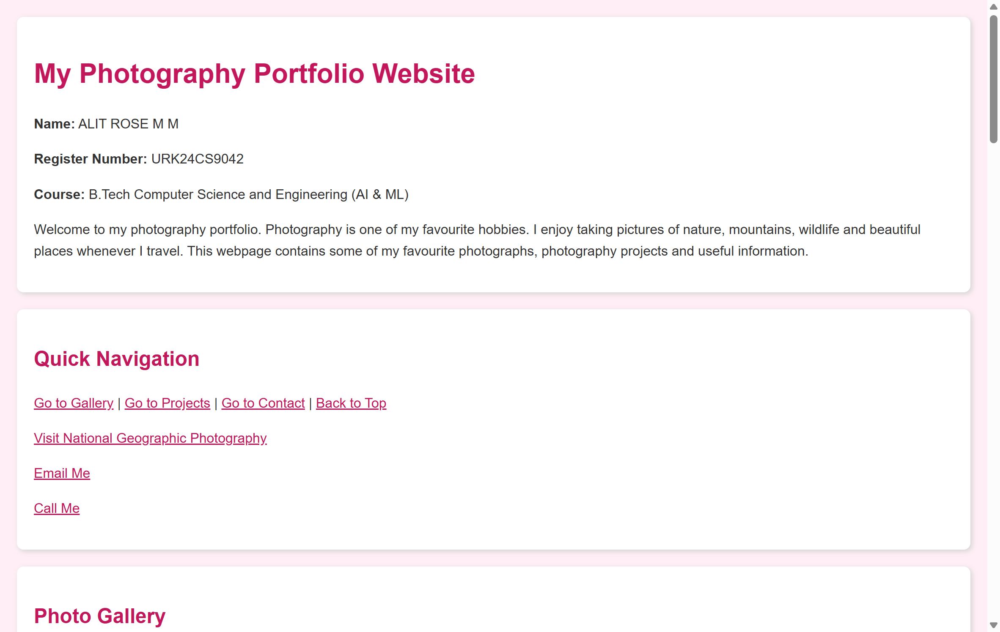
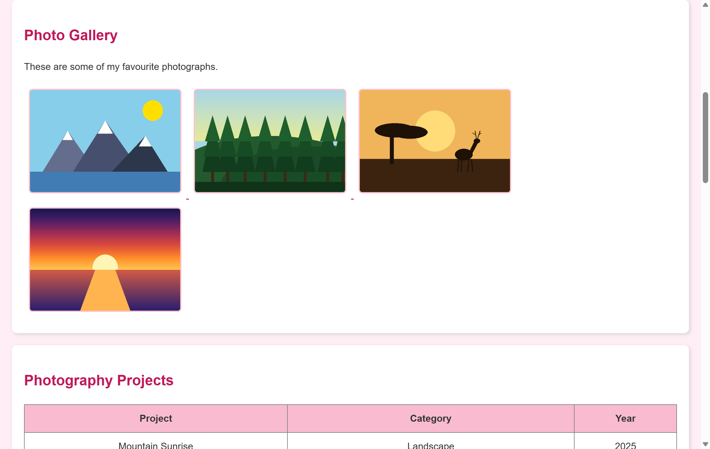
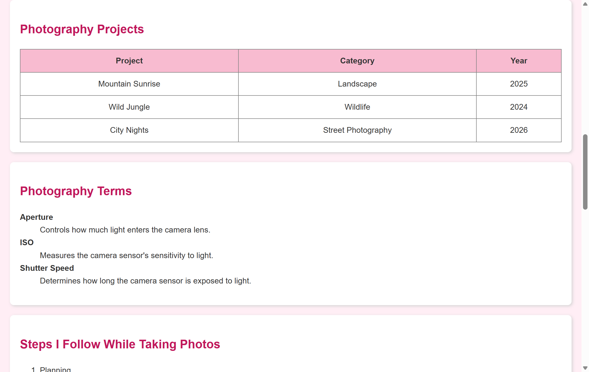
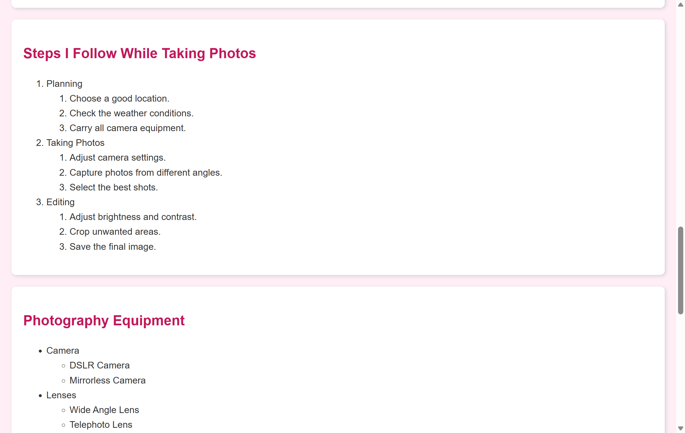
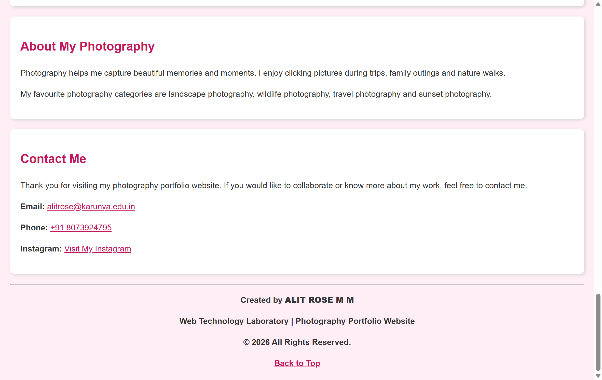

# Experiment 1: Design A Website Using HTML5

- **Course Code:** 23CS2049 – Web Technology Laboratory
- **Student Name:** ALIT ROSE M M
- **Register Number:** URK24CS9042
- **Practical Date:** 10th July 2026

---

## Aim
To design and develop a simple Photography Portfolio Website using HTML5 and internal CSS by implementing fundamental HTML elements such as headings, paragraphs, images, tables, lists, hyperlinks, and semantic tags to create a well-structured and visually appealing web page.

---

## Description
This exercise involves designing and developing a simple Photography Portfolio Website using HTML5 and basic CSS. The website consists of a single web page that demonstrates the proper use of fundamental HTML tags, semantic elements, and formatting techniques. The portfolio includes multiple sections such as a photo gallery, photography projects, photography terms, equipment lists, and contact information. It incorporates headings, paragraphs, images, tables, hyperlinks, description lists, ordered and unordered nested lists, and HTML comments. Internal CSS is used to apply a light pink background and appropriate text colors, creating an attractive and user-friendly interface while following HTML5 standards.

---

## Procedure
1. Chose the theme "Photography Portfolio Website" for the web application.
2. Created a new HTML5 file named index.html using Visual Studio Code.
3. Added the <!DOCTYPE html> declaration to define the document as an HTML5 webpage.
4. Used the required HTML5 semantic tags such as <html>, <head>, <meta>, <title>, and <body>.
5. Designed the webpage by dividing it into different sections using 
 elements.
6. Added a main heading (<h1>) for the website title and section headings (<h2>) for Gallery, Projects, Photography Terms, Equipment, Contact, and other sections.
7. Included multiple 
 tags to provide information about photography and the portfolio.
8. Implemented different types of hyperlinks:
   • External hyperlink to a photography website (target="_blank").
   • Internal hyperlinks for navigating between sections.
   • Bookmark link to return to the top of the page.
   • Email link using mailto:
   • Phone link using tel:
   • Clickable image links in the gallery.
9. Added multiple images using the  tag to create a photography gallery.
10. Created a table to display photography projects with their categories and year.
11. Added a description list (<dl>, <dt>, <dd>) to explain common photography terms.
12. Created an ordered nested list to show the photography workflow.
13. Created an unordered nested list to display photography equipment and accessories.
14. Added HTML comments to identify each major section of the webpage.
15. Applied internal CSS to set a light pink background, text colors, table formatting, image borders, and basic styling.
16. Ensured the HTML code was properly indented, clean, and semantically correct.
17. Saved the file and viewed it in a web browser to verify that all elements displayed correctly.
18. Uploaded the project to GitHub and deployed it using GitHub Pages.

---

## Source Code Files

- [`index.html`](./index.html) - index.html

---

---

## Output Screenshots

### 1. Header & Navigation (ALIT ROSE M M - URK24CS9042)

### 2. Photo Gallery Showcase Grid

### 3. Photography Projects Table & Terms Description List

### 4. Workflow Nested Lists & About Photography Section

### 5. Contact Information & Footer

## Result
The Photography Portfolio Website was successfully designed and implemented using HTML5 and internal CSS. All the required HTML elements, hyperlinks, images, lists, tables, and formatting techniques were incorporated, and the webpage was executed successfully with the expected output.
